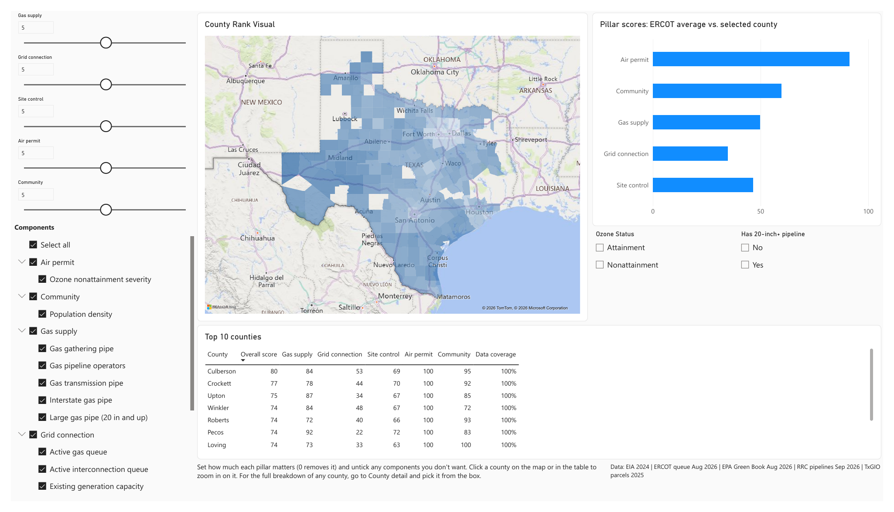

# ERCOT Gas Plant Siting Screen

Where in Texas would you build a new gas-fired power plant? This project scores all 195 counties on the ERCOT grid against the things a developer checks first: gas supply, grid connection, land, air permits and the local community. You decide how much each one matters, and the report re-ranks the counties.

Built with SQL Server, Python and Power BI, using only public data.



*Figure 1. The main page with all five pillars weighted equally. Darker counties score higher. The bar chart shows the ERCOT average for each pillar, with the selected county overlaid. The table lists the top 10 counties.*

## See it without building anything

- **Interactive report:** download `ercot_siting_screen.pbix` from the [latest release](https://github.com/ishaanmadhivanan/ercot-siting-screen/releases/latest) and open it in [Power BI Desktop](https://www.microsoft.com/en-us/power-platform/products/power-bi/desktop) (free, Windows only). The data is saved inside the file, so the sliders, map and county pages all work. Refresh won't, since that needs the database.
- **Quick look:** [all four report pages as a PDF](docs/ercot_siting_report.pdf), with default weights.

## How the score works

Each county gets a 0–100 score on 17 factors, grouped into five pillars:

| Pillar | What goes into it |
| --- | --- |
| Gas supply | Miles of gas transmission pipe, miles of 20-inch+ pipe, interstate pipe, number of pipeline operators, gathering pipe (a sign of nearby production) |
| Grid connection | Existing generating capacity, how hard all local plants and local gas plants run, generation trend 2020–2024, gas projects in the interconnection queue, total queue |
| Site control | Old gas and coal plants (brownfield sites), share of land in 100+ acre parcels, landowners per 1,000 rural acres, number of 500+ acre parcels |
| Air permit | Ozone nonattainment severity |
| Community | Population density |

A pillar's score is the average of its factors. The overall score is the average of the pillars, weighted by the sliders. Untick a factor and it drops out; set a slider to 0 and the whole pillar drops out.

The County detail page (pick a county in the box at the top left) shows every number behind a county's score, a Background info table with everything that isn't scored (ozone class, NOx offset costs, LNG terminals, parcel data checks), and the county's pipelines and power plants. The Catalog page lists every metric with its source, date and a plain note on how it's scored.

## Data

| Source | Used for | As of |
| --- | --- | --- |
| EIA Form 860 | Power plants: location, capacity, fuel, age | 2024 |
| EIA Form 923 | Monthly generation, 2020–2024 | 2024 |
| ERCOT GIS Report | Interconnection queue | Aug 2026 |
| US Census | Population and land area | 2025 |
| EPA Green Book | Ozone nonattainment | Aug 2026 |
| TCEQ emission credit trades | NOx credit prices | Sep 2026 |
| Railroad Commission of Texas | Gas pipelines | Sep 2026 |
| TxGIO land parcels | Parcel size and ownership (11 million records) | 2025 |

## What I found

- **Air permits are limited by supply, not just price.** Houston and Dallas–Fort Worth are in severe ozone nonattainment, so a new plant has to buy 1.3 tons of NOx credits for every ton it emits. Houston's whole credit market traded 87 tons in two years. One 100-ton-a-year plant would need 130.
- **Big gas pipe is concentrated.** Most of the 20-inch+ pipe is in Harris, Pecos, Reeves, Brazoria and Wharton counties.
- **Planned retirements barely show up in public data.** EIA lists planned ERCOT retirements through 2030 only in Bexar County, so I used plant age (40+ years) to find likely brownfield sites instead.

## Data problems I had to fix

| Problem | Fix |
| --- | --- |
| El Paso ranked #1 even though it isn't on the ERCOT grid (one retired plant was coded ERCOT) | A county counts as ERCOT only if most of its operating capacity is |
| Averaging many factors squeezed every county into a narrow band of scores | Score each factor 0–100 on its own before combining |
| 30 counties tied for the best generation trend because they had zero generation | Smoothed the ratio |
| EPA's two-digit years made "99" look like the latest year | Used the page's own date instead |
| Some parcels appear up to 134 times, once per co-owner | Counted each parcel shape once |
| Some counties calculated parcel acreage on a distorted map projection (about 38% too large) | Recalculated every parcel's area |
| Land-use codes are blank or wrong in about two thirds of counties | Scored land on parcel size and ownership only |
| Harris County's parcel file covers only 40% of the county | Left land scores blank where coverage is under 80% or over 125% |

More detail in [docs/methodology.md](docs/methodology.md).

## Limitations

- It works at county level. It narrows the search to a shortlist; it doesn't pick a site.
- Pipe diameter stands in for pipeline capacity, which isn't public for intrastate lines. Existing plants and the queue stand in for grid headroom, which needs substation-level data.
- Not covered yet: water, rail and heavy-haul road access, flood zones and wetlands, power prices, tax incentives.

## Running it yourself

1. `pip install -r requirements.txt`
2. Download the sources into `data/raw/` (each script's header has the link) and run the scripts in `scripts/`. For parcels, run `scripts/download_parcels.ps1 -ErcotOnly` from a home internet connection; the TxGIO server blocks cloud IPs.
3. In SSMS, run the SQL files in number order: `sql/01_schema`, `sql/02_load` (set the `@repo` path at the top first), `sql/03_views`, then `sql/04_checks`.
4. Open `powerbi/ercot_siting_v2.pbip` in Power BI Desktop and click Refresh. If your server isn't `localhost\SQLEXPRESS`, change it under Transform data → Edit parameters.

The Power BI files are generated by `scripts/build_powerbi_project.py`, so make report changes there.

## Folders

```
data/seed/        small reference tables
data/raw/         source downloads (not in git)
data/processed/   script output (not in git)
sql/              tables, loads, scoring views, checks
scripts/          Python extract scripts and the Power BI generator
powerbi/          Power BI project
docs/             methodology, screenshot and PDF of the report
```

## Next

A web map that starts from the county shortlist and narrows down to actual parcels: 100+ acres, close to a large gas line and a high-voltage substation, out of the floodplain. With presets for gas plants, wind farms and data centers.
